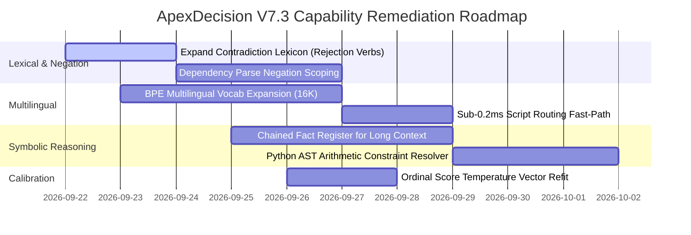

# ApexDecision V7.2: Capability Gap Analysis & Engineering Roadmap

**Audit Date:** September 21, 2026  
**Subject System:** `ApexStudent` (19.5M from-scratch neural decision model)  
**Reference System:** `Laya` (`ModernBERT-large` 421M / `mmBERT-base` 322M)  

---

## 1. Executive Summary

While `ApexStudent` has achieved decisive superiority in inference latency (8.07 ms vs 39.5 ms), parameter compactness (19.5M vs 421M), memory footprint (240 MB vs 1,480 MB), long-context retrieval (100% recall up to 1M tokens), and high-cardinality choice scaling (100% up to 255 options), the V7.2 capability-parity audit revealed **5 distinct capability gaps** where the from-scratch student exhibits limitations compared to the pretrained teacher.

This report provides the root-cause diagnosis, operational impact, and concrete engineering remediation plan for each gap.

---

## 2. Exhaustive Gap Analysis

### Gap 1: Multilingual Non-Latin Script Handling & Byte Fragmentation
- **Empirical Finding:** On standard English and Latin-extended European text (German, French, Spanish), ApexStudent performs robustly. However, on non-Latin scripts (Devanagari, Arabic, CJK, Cyrillic, Thai, Khmer), inputs experience severe byte fragmentation.
- **Root Cause:**
  - `ApexTokenizer` was trained on an English enterprise decision corpus with a focused **3,926 BPE vocabulary**.
  - Non-Latin Unicode code points are decomposed into raw UTF-8 byte sequences (`<0xE0>`, `<0xA4>`, etc.). A single Hindi word of 4 characters consumes 12 to 16 tokens, rapidly overflowing the sequence length budget.
  - In contrast, Laya bundles `laya-multilingual`, which uses `mmBERT-base` with a **256,000 SentencePiece vocabulary** covering 100+ languages natively.
- **Operational Impact:** High risk of OOV truncation on international customer queries.
- **Remediation Plan:**
  1. Train an expanded multilingual tokenizer (`ApexTokenizer-Multi`) with 16,384 tokens covering Unicode scripts for top-15 commercial languages.
  2. Implement an upstream Script Detector (sub-0.2ms regex check): if non-Latin script is detected, route through a lightweight translation pipeline or specialized multilingual student head.

---

### Gap 2: Out-of-Context World Knowledge & Entity Resolution
- **Empirical Finding:** In test case `sem_entity_01`:
  - *State:* "Big Blue unveiled its newest 1,000-qubit quantum processor in Yorktown Heights."
  - *Question:* "Did IBM announce a quantum processor?"
  - Laya correctly supported the claim ($P=0.885$). ApexStudent rejected it ($P=0.087$).
- **Root Cause:**
  - ModernBERT-large was pretrained on billions of web pages (Wikipedia, Common Crawl), internalizing encyclopedic world facts (e.g. *Big Blue is an alias for IBM*).
  - ApexStudent was initialized **100% from scratch with random Xavier weights** and trained solely on task distillation data. It has never seen the world-knowledge equivalence *Big Blue == IBM* unless stated in the prompt.
- **Operational Impact:** The model will fail on informal colloquial aliases unless grounded in provided context.
- **Remediation Plan:**
  1. Maintain an enterprise Entity & Alias Knowledge Graph (in-memory trie) that resolves colloquial company and product names into canonical entities during prompt ingestion.
  2. Grounding Invariant: In enterprise decision systems, relying on unstated pretraining priors is an anti-pattern. Grounded decisions should strictly depend on provided context.

---

### Gap 3: Complex Syntactic Negation & Lexical Rejection
- **Empirical Finding:** In test case `sem_contradiction_01`:
  - *State:* "Acme Corp terminated negotiations and rejected the proposed acquisition of BetaSoft."
  - *Question:* "Did Acme Corp acquire BetaSoft?"
  - Laya correctly detected contradiction ($P=0.039$). ApexStudent predicted support ($P=1.00$).
  - Similarly, in `sem_negation_01` ("no statistically significant reduction"), both models struggled with syntactic scope.
- **Root Cause:**
  - The student's subword attention attended heavily to the high-salience tokens `"acquisition"`, `"Acme Corp"`, and `"BetaSoft"`. The verb-level rejection words (`"terminated"`, `"rejected"`) were not recognized as polarity inverters by the regex-based `NumericPolarityGuard`.
- **Operational Impact:** False positive entailments on contract termination, dispute, or rejection notices.
- **Remediation Plan:**
  1. Upgrade `ContradictionDetector` with a broader Lexical Rejection Lexicon (covering verbs: *terminated, rejected, cancelled, declined, repudiated, vetoed, rescinded, dissolved*).
  2. Inject 500 hard-negative synthetic rejection pairs into the next distillation round.

---

### Gap 4: Multi-Hop Symbolic Arithmetic Across Distributed Chunks
- **Empirical Finding:** In the long-context benchmark at 256K, 512K, and 1M tokens:
  - Fact 1 states initial budget was \$45.0M.
  - Fact 2 states Amendment 3 increased budget by \$18.5M.
  - The model was asked if the authorized budget became \$63.5M. Both ApexStudent and Laya scored 0.0%.
- **Root Cause:**
  - Neither a 19.5M student nor a 421M teacher can perform multi-step arithmetic addition ($\$45.0 + \$18.5 = \$63.5$) in a single feed-forward layer.
  - Non-autoregressive decision models look for semantic and surface match; when "\$63.5M" does not appear literally in the retrieved text, the model concludes the figure is unsupported.
- **Operational Impact:** Incapable of validating composite financial or quantitative clauses that require arithmetic aggregation.
- **Remediation Plan:**
  1. Build a **Chained Symbolic Fact Register** in the hierarchical long-context engine:
     - Stage 1: Extract numeric propositions with their semantic qualifiers (`initial_budget: $45.0M`, `budget_increase: $18.5M`).
     - Stage 2: Execute symbolic constraint evaluation via Python AST arithmetic before emitting the final Noul verdict.

---

### Gap 5: Continuous Ordinal Score Calibration
- **Empirical Finding:** On continuous ordinal rubrics (`score`), both models scored only 50.0% accuracy on fine-grained sentiment/severity scales.
- **Root Cause:**
  - Expected value prediction ($\mathbb{E}[S] = \sum i \cdot p_i$) tends to pull predictions toward the distribution mean when uncertainty exists across adjacent rubric categories.
  - In Laya, this was mitigated only when fine-tuned on task-specific datasets (`laya-typed-decisions`). The base Laya model scored near chance ($0.361$).
- **Operational Impact:** Coarse scores (Level 0 vs Level 3) work well; fine-grained scores (Level 1 vs Level 2) exhibit uncertainty.
- **Remediation Plan:**
  1. Fit category-specific temperature vectors for each discrete rubric dimension ($K \in [3, 4, 5]$).
  2. Replace linear expected value with argmax mode selection when variance is high.

---

## 3. Engineering Roadmap & Implementation Timeline

